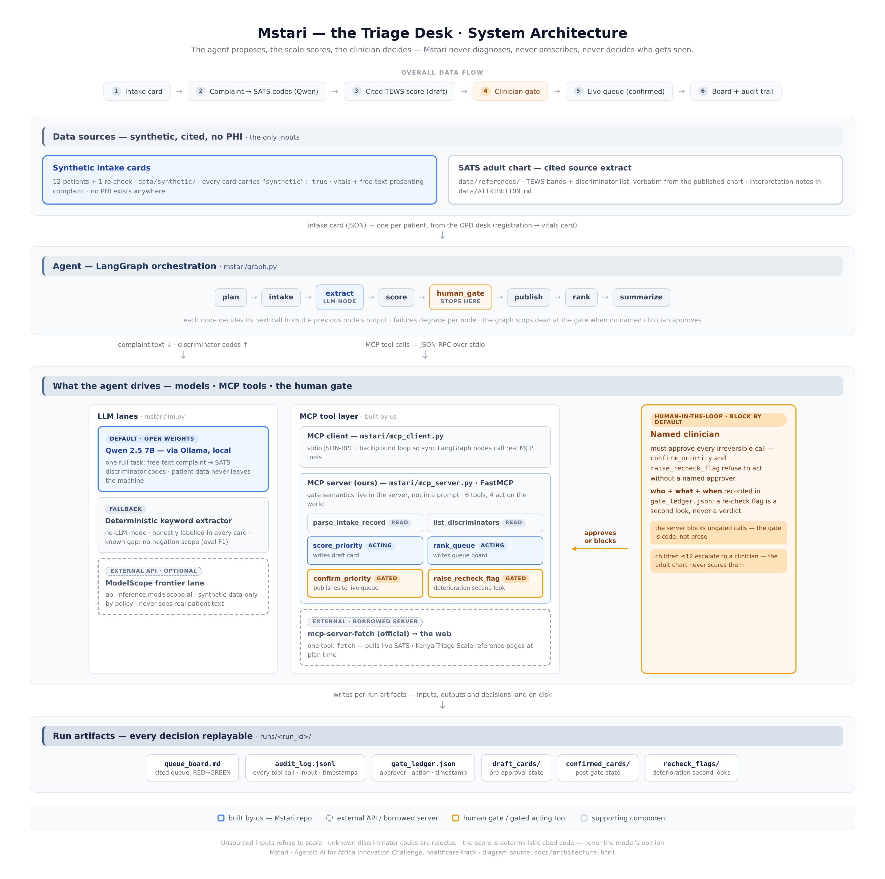

# Mstari — the Triage Desk

**Mstari** (Swahili: *the queue*) is an agentic triage desk for busy public
outpatient departments. It reads each patient's intake card, turns vitals +
the presenting complaint into a **cited South African Triage Scale (adult
chart)** priority, and sequences the queue for the triage nurse — with every
priority carrying the exact vitals behind it.

**It scores and sequences the queue. It never diagnoses, never prescribes,
never decides who gets seen.** A named clinician confirms every priority
before it reaches the queue — that gate is enforced in code, not in prose.

Built for the **Healthcare: The Triage Desk** track of the *Agentic AI for
Africa Innovation Challenge*. Sub-theme: **symptom-based priority scoring**
(grounded in the SATS adult chart, the scale behind Kenya's Kenya Triage
Scale), with a **deterioration-watch** second-look flag. Serves the OPD triage
desk of a Level 2–4 public facility; workflow: registration → vitals card →
Mstari scores & sequences → nurse confirms → bay.

> This repository is **new work built during the submission period**. It is a
> ground-up rebuild of the author's earlier "Health-advisor" prototype, which
> was retired because it violated the track's non-negotiable rule (it produced
> diagnosis-style advice). Mstari keeps the original idea — intake in, help
> out — and rebuilds it inside the track's guardrails.

**Contents:** 1. [Problem statement](#1-problem-statement) ·
2. [Solution overview](#2-solution-overview) · 3. [Target users](#3-target-users) ·
4. [Architecture](#4-architecture) · 5. [Setup / installation](#5-setup--installation) ·
6. [Usage](#6-usage) · 7. [Technology stack](#7-technology-stack) ·
8. [Agent architecture](#8-agent-architecture) · 9. [MCP implementation](#9-mcp-implementation) ·
10. [MCP tools / servers](#10-mcp-tools--servers) ·
11. [Human-in-the-loop workflow](#11-human-in-the-loop-workflow) ·
12. [Limitations](#12-limitations) · 13. [Future improvements](#13-future-improvements) ·
14. [Other](#14-other)

## 1. Problem statement

In Level 2–4 public facilities across East Africa, the outpatient department
(OPD) opens onto a queue that routinely runs to dozens or hundreds of
patients, met by one or two triage nurses. Prioritisation on paper is fast to
teach but slow to keep consistent: two nurses can read the same vitals
differently, the sickest-looking patient can sit unlabelled behind a queue
that was formed by order of arrival, and the depth of the coloured bands is
invisible until someone physically counts the files. The most dangerous
failure is quieter: a patient who was correctly scored at 09:40 but
deteriorates at 11:15 while still waiting — nothing in a paper-based desk
systematically looks again. The track brief frames the problem exactly: the
bottleneck is **ordering, visibility and deterioration-watch at the triage
desk**, not diagnosis. Clinicians diagnose; the desk needs an instrument that
keeps the queue honestly sorted, cites why every patient sits where they sit,
and re-checks the waiting.

## 2. Solution overview

Mstari is a LangGraph-orchestrated agent that works behind the triage nurse,
not instead of her. Each patient arrives as an intake card (vitals + free-text
presenting complaint). The agent reads the complaint and maps it onto the
**SATS adult chart discriminator list** using an open-weights model
(Qwen 2.5 via Ollama, running locally — with an honest deterministic keyword
fallback when no LLM is configured), then computes the **Triage Early Warning
Score** with deterministic, cited code — the model never invents a priority.
The output is a sequenced queue board: RED (immediate) → ORANGE (<10 min) →
YELLOW (<60 min) → GREEN (<240 min), longer-waiting patients first within a
colour, every entry citing the exact vitals and discriminator codes behind it.
Before any priority reaches the live queue, a **named clinician must approve
it at a code-enforced gate**. If re-check vitals show a waiting patient has
worsened, the agent raises a second-look flag citing both vital sets — it
never changes the score itself. Every tool call is written to a JSONL audit
log and every gate decision to a gate ledger.

## 3. Target users

- **Primary — the OPD triage nurse** at a Level 2–4 public facility (e.g. a
  county referral hospital outpatient department). Mstari is a queue
  instrument for her desk: it proposes, she confirms, the bay follows.
- **Duty clinicians** who action the gated second-look flags on waiting
  patients whose re-check vitals have worsened.
- **Facility records / audit officers**, who get a timestamped JSONL record
  of every tool call and every gate decision without touching the workflow.
- **County health managers and researchers**, who can reuse the eval harness
  (15 tasks + 1 documented failure) and the synthetic data generator to adapt
  the desk to their own facilities.
- **Explicitly not a target user: the patient.** Mstari is deliberately not a
  patient-facing self-diagnosis app; nothing in it gives advice to the public.

## 4. Architecture

Three layers: an **MCP tool layer** (our own FastMCP server over stdio, plus
one borrowed official server), a **LangGraph orchestration layer** (the agent
pipeline with the human gate as a first-class node), and an **LLM layer** with
honest, labelled lanes (local open-weights Qwen by default; deterministic
heuristic fallback; optional frontier lane for synthetic data only). All
artifacts land on disk per run, so every decision is replayable.



*Diagram source: [`docs/architecture.html`](docs/architecture.html) (editable HTML, rendered to
`docs/architecture.png`). It maps the agents, the LLM lanes, the MCP client/server and its six
tools, the external APIs, the data sources, the human-in-the-loop gate, and the overall data flow.*

Full one-page design (division of labour, why-agent-not-a-script, MCP
built-vs-borrowed rationale): see [`ARCHITECTURE.md`](ARCHITECTURE.md).

## 5. Setup / installation

Prerequisites: **Python 3.10+** and git. *Optional:* [Ollama](https://ollama.com)
for the open-weights LLM lane.

**One command** (creates a virtualenv, installs dependencies, generates the
bundled synthetic intake cards, runs the evaluation suite, then runs the full
agent over a 12-patient OPD queue):

```bash
./run_demo.sh
```

**Manual install**, if you prefer to drive each step:

```bash
python3 -m venv .venv
source .venv/bin/activate
pip install -r requirements.txt
python -m mstari.main evals        # 15 pass + 1 documented failure (F1)
python -m mstari.main demo         # full queue run, stops at the clinician gate
```

**Optional — enable the open-weights lane** (auto-detected by `run_demo.sh`;
patient data never leaves the machine):

```bash
ollama pull qwen2.5:7b
```

## 6. Usage

```bash
# heuristic mode (no LLM needed) — clearly labelled in the summary
./run_demo.sh

# with the named clinician who will approve priorities at the gate
./run_demo.sh "Sr. A. Wanjiru (Triage Nurse)"

# override the Ollama model
MSTARI_LLM_MODEL=qwen2.5:7b ./run_demo.sh "Sr. A. Wanjiru (Triage Nurse)"

# run the evaluation suite on its own
python -m mstari.main evals
```

Artifacts land in `runs/<run_id>/`:

| Artifact | What it is |
|---|---|
| `queue_board.md` | the cited queue: every patient, every priority, every source vital |
| `audit_log.jsonl` | one JSON line per tool call: inputs, outputs, timestamps |
| `gate_ledger.json` | every gate decision — block or approve, approver + timestamp |
| `draft_cards/`, `confirmed_cards/`, `recheck_flags/` | the paper trail per patient |

**LLM modes (honest by design).** With Ollama running, `run_demo.sh`
auto-selects the **open-weights lane** (`qwen2.5:7b` by default). The
open-weights model performs the full task of reading each free-text complaint
and mapping it to SATS discriminator codes; the score itself is always
deterministic cited code (`mstari/scale.py`). No endpoint configured →
deterministic heuristic mode. Either way the repo runs end-to-end.

## 7. Technology stack

| Layer | Choice | Why |
|---|---|---|
| Language | Python 3.10+ | the MCP SDK and LangGraph are first-class here |
| Orchestration | **LangGraph** (`langgraph>=0.2`) | open-source OSS framework; the graph is inspectable and the human gate is a real node |
| Agent–tool protocol | **MCP** (`mcp>=1.2,<2`, FastMCP) | our own server over stdio; every action is a genuine logged tool call |
| Borrowed MCP server | `mcp-server-fetch` (official reference server) | pulls live SATS reference pages; declared in `mcp_config.json` with a one-line justification |
| Open-weights model | **Qwen 2.5 (7B)** via Ollama, local | performs the complaint → discriminator task on-device; no patient data leaves the machine |
| Optional frontier lane | ModelScope API-inference (Qwen frontier models) | **synthetic-data-only** by policy; never sees real patient text (there is none) |
| Scoring core | deterministic `mstari/scale.py` | cited TEWS implementation of the published SATS adult chart |
| Tests | pytest | 11 deterministic unit tests for the scoring core |
| Audit | JSONL + JSON artifacts | replayable run record per run id |
| Licence | MIT | OSI-approved, in `LICENSE` |

## 8. Agent architecture

**LangGraph pipeline with a clinician gate as a first-class node:**
`plan → intake → extract → score → human_gate → publish → rank → summarize`.

- `plan` decides the run shape and may pull live scale references via the
  borrowed `fetch` server; `intake` normalises a synthetic intake card;
  `extract` is the LLM node (complaint text → SATS discriminator codes,
  keyword fallback if no model); `score` calls the deterministic scale and
  writes a DRAFT card; `human_gate` stops the graph dead without a named
  approver; `publish`/`rank` write the confirmed queue board; `summarize`
  prints the run summary and the honesty labels.

**Division of labour (the safety core):**

1. **The LLM reads** — free-text complaint → discriminator codes. That is the
   model's one full task.
2. **The scale scores** — `mstari/scale.py` is deterministic, cited code. The
   model never invents a priority.
3. **The clinician decides** — gated tools block by default; approval is a
   named person plus a timestamp, recorded in the gate ledger.
4. **The guardrails sweep** — diagnosis-like vocabulary in any LLM narrative
   is redacted and logged; prescription-like phrasing is hard-blocked.

Why an agent and not a script: each node decides its next call from the
previous node's output, failures degrade gracefully per node, and the graph
genuinely stops at the gate when no named clinician approves. Details in
[`ARCHITECTURE.md`](ARCHITECTURE.md).

## 9. MCP implementation

- **Our own server** (`mstari/mcp_server.py`): a FastMCP server over stdio
  exposing six tools (below). Gate semantics live *inside the server*, not in
  the agent's prompt — `confirm_priority` and `raise_recheck_flag` refuse to
  act without a named clinician, no matter what the graph asks for.
- **A real MCP client** (`mstari/mcp_client.py`): a background-loop stdio
  client so synchronous LangGraph nodes can call tools as genuine MCP calls.
  Every action the agent takes is therefore a real, logged MCP tool call —
  the same server any external MCP client (e.g. Claude Desktop) could attach
  to.
- **One borrowed server**: the official `mcp-server-fetch`, declared alongside
  ours in `mcp_config.json` with an inline one-line justification: *it pulls
  live SATS / Kenya Triage Scale reference pages and facility-directory
  updates at plan time — writing our own web crawler would be fragile,
  duplicated work for zero clinical value.* Verified callable in evals (T15).

## 10. MCP tools / servers

**Server: `mstari` (built by us)** — `mstari/mcp_server.py`

| Tool | Kind | Notes |
|---|---|---|
| `parse_intake_record` | read | normalises a synthetic intake card into scored fields |
| `list_discriminators` | read | the SATS adult discriminator list with citations |
| `score_priority` | **acting** | computes the cited TEWS priority, writes a DRAFT card |
| `confirm_priority` | **acting, GATED** | publishes a priority to the live queue — named clinician required |
| `rank_queue` | **acting** | writes the cited queue board |
| `raise_recheck_flag` | **acting, GATED** | deterioration second-look flag — named clinician required |

Four of six tools act on the world; the two irreversible ones are gated.
Six tools ≥ the track's three-tool minimum.

**Server: `fetch` (borrowed — the one we did not write)** — official
`mcp-server-fetch`, one tool (`fetch`), justified inline in
[`mcp_config.json`](mcp_config.json) and verified in evals (T15).

## 11. Human-in-the-loop workflow

The track's rule: irreversible actions need a **named human approver**. In
Mstari the irreversible actions are publishing a priority to the live queue
and raising a re-check flag on a real patient.

1. The graph reaches `human_gate` with a DRAFT card and stops.
2. `confirm_priority` is called **without** approval → the server **blocks**,
   and the block is logged to the gate ledger.
3. With an approver (`./run_demo.sh "Sr. A. Wanjiru (Triage Nurse)"`), the
   gate records **who**, **what**, and **when** in `gate_ledger.json`, and the
   card is published to its queue position.
4. Block-by-default is a property of the MCP server, not a prompt: the tool
   itself refuses ungated calls.
5. Re-check flags are "a second look, not a verdict": the agent flags,
   the clinician re-examines — the agent never alters a confirmed priority.

## 12. Limitations

- **Negation handling (known, unfixed, on purpose):** the keyword fallback
  extractor has no negation scope, so "denies chest pain" can over-triage to
  ORANGE. Documented as eval task **F1** in [`EVALS.md`](EVALS.md); the error
  is in the safe direction, and it is reproducible.
- **English-only complaint text** in the current discriminator mapping.
- **Adult chart only.** Children ≤12 are escalated to a clinician, never
  scored by the adult chart; the paediatric chart is not implemented yet.
- **Two interpreted SATS chart cells** (documented in
  [`data/ATTRIBUTION.md`](data/ATTRIBUTION.md)) where the source chart's
  wording required an interpretation; both are cited.
- **Synthetic data only.** All intake cards are fabricated (`"synthetic": true`);
  there is no real-patient evaluation in this repository.
- **Frontier-model lane untested end-to-end** pending a rotated ModelScope
  key; the lane is documented synthetic-only and the repo never depends on it.
- **No UI.** The queue board is a markdown artifact; wiring a live dashboard
  or HMS integration is future work.
- **Single-facility scope.** Queue semantics (bay naming, shift handover,
  multi-desk concurrency) are simplified.

## 13. Future improvements

- **Fix F1 properly:** a negation-scope pass over the complaint text plus a
  second open-weights adjudicator vote before extraction is accepted.
- **Paediatric chart support:** implement the SATS paediatric columns so
  children are scored by the right scale instead of blanket escalation.
- **Swahili (and code-switched) complaint intake** for real OPD language
  realities, with the same cited-derivation discipline.
- **Delivery where the queue lives:** SMS/WhatsApp rendering of the queue
  board for facilities without a shared screen.
- **FHIR / HIE integration:** read intake cards from registration systems and
  write confirmed priorities back as observations.
- **Queue analytics:** per-day time-to-see by colour band, gate turnaround
  times, and re-check outcomes for facility managers.

## 14. Other

### Evaluation & known failure

Fifteen evaluation tasks pass; one failure (**F1**, negation handling) is
documented and reproducible — see [`EVALS.md`](EVALS.md) or run:

```bash
python -m mstari.main evals
```

### Track compliance map

| Requirement | Where |
|---|---|
| Own MCP server, 3+ tools, ≥1 acting | `mstari/mcp_server.py` — 6 tools, 4 acting, 2 gated |
| One MCP server we did not write + why | official `mcp-server-fetch`, wired in `mcp_config.json` (justification inline; verified in evals T15) |
| OSS orchestration | LangGraph (`mstari/graph.py`): plan → intake → extract → score → gate → publish → rank → summarize |
| One full task on open-weights model | complaint → discriminator extraction on Ollama Qwen (`mstari/llm.py`); patient data never leaves the machine |
| Logged tool call for every action | `runs/<run_id>/audit_log.jsonl` — inputs, outputs, timestamps |
| Gate on every irreversible action | `mstari/gates.py` + `confirm_priority` / `raise_recheck_flag` — named clinician, timestamped, blocked-by-default |
| Never diagnose / prescribe / decide | `mstari/guardrails.py` (lexicon scrub + hard block), deterministic score, clinician gate, citations everywhere |
| Grounded in an existing scale | SATS adult chart; sources + interpretation notes in `data/ATTRIBUTION.md` |
| OSI licence | MIT (`LICENSE`) |
| 8+ eval tasks incl. one unfixed failure | `EVALS.md` — 15 pass, F1 intentionally unfixed |
| Architecture doc | `ARCHITECTURE.md` |
| Demo video (unedited, tool calls on screen) | shot list in `VIDEO_SCRIPT.md` |

### Repository layout

```
mstari/            the agent: mcp_server, mcp_client, graph (LangGraph),
                   scale (SATS TEWS), llm, guardrails, gates, queue, evals
data/synthetic/    fabricated intake cards (no real patient data, ever)
data/references/   verbatim SATS chart source extract + ATTRIBUTION.md
runs/              per-run artifacts: queue boards, audit log, gate ledger
tests/             deterministic unit tests for the scoring core
run_demo.sh        the one command
```

### Notes on safety & data

- **All patient data in this repo is synthetic** (`"synthetic": true` on every
  card). No PHI exists, is stored, or is transmitted. Default LLM lane is
  local (Ollama); the optional frontier lane is documented as synthetic-only.
- The agent's failure posture is conservative: missing vitals → refuse to
  score; unknown discriminator codes → reject; child → escalate; gate → block
  by default.
- Known limitations are documented, not hidden: see `EVALS.md` (negation
  handling, F1) and `data/ATTRIBUTION.md` (two interpreted chart cells).

### Licence & attribution

MIT — see [`LICENSE`](LICENSE). SATS adult chart source, interpretation notes
and data provenance: [`data/ATTRIBUTION.md`](data/ATTRIBUTION.md) and
[`data/references/sats_adult_chart_source.md`](data/references/sats_adult_chart_source.md).
